<p align="center">
  <a href="assets/logo.png">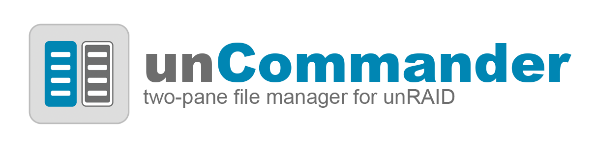</a>
</p>


<p align="center">
  <b>The two-pane file manager unRAID always deserved</b><br>
  Fast, safe, and built for real media libraries
</p>

<p align="center">
  <a href="https://www.buymeacoffee.com/hernandito" target="_blank"></a>
</p>

unCommander (uC for short) is a plugin that adds a full **Midnight Commander–style, two-pane file manager** to the unRAID webGUI. There's nothing to SSH into and no Docker container to set up. Open it from the top menu and start working with your shares, disks and pools.

It works with a **mouse**, a **keyboard** and an **iPad**. Folders with tens of thousands of files open **instantly**. **Every change can be undone**, and nothing is ever deleted without a way back.


Developed with assistance from Claude AI.

---

## ✨ Highlights

| | |
|---|---|
| ↩️ **Undo anything** | Every rename, move, copy, delete and permission change goes into History. Undo any step - even days later. |
| ⚡ **Instant on huge folders** | Tens of thousands of files open instantly - sizes and dates load only for the rows you can see. |
| 🖱️ **Feels like a desktop app** | Right-click menus, drag and drop, Copy / Cut / Paste, upload and download - with a mouse, a keyboard or your fingers on an iPad. |
| 🗜️ **Walk into archives** | Open a .zip, .rar, .7z, .tar.gz or .iso just like a folder - view, play and copy out, as in Midnight Commander. |
| 🧰 **Powerful tools** | See **what's using your space**, find the hidden **duplicate** copies your shares merge away, clear **empty leftover folders**, and fix **movie, TV and music** folders with **Radarr, Sonarr** and **Lidarr**. All in the top bar's Tools button. |
| 🎬 **Made for media** | Gallery view, a picture editor, and a video player that plays almost anything - subtitles included. |
| 🎧 **Your music, built in** | A music player right in unCommander - browse your library by artist and album with covers, queue it up and listen. No separate music server needed. **Drag and drop** songs, albums or whole artists to build playlists, then **export them to your apps** - Plex, Kodi, Jellyfin and more. Plus a tag editor with MusicBrainz. |
| 💻 **Terminal built in** | unRAID's own terminal right under the panes - click a folder name to `cd` there. |
| 🎨 **Make it yours** | Colour themes (including a Norton homage), F-key layouts from Windows or MC, your own CSS. |
| 🛡️ **Safe by design** | A restorable trash, Practice mode, and guards that refuse to copy a disk folder onto its own share. |

**Ready to try it?** Open the **Apps** tab in unRAID and search for **unCommander**. ([Install details](#-install))

---

## 🆕 New in 2026.11 - the biggest update yet

Already using unCommander? This release is packed. Since the first version you'll find:

- **Right-click menus** everywhere (press and hold on the iPad), **Copy / Cut / Paste**, **drag and drop** between panes, **upload** by dropping files in, and **download** a file or a whole selection as a zip.
- **Undo History:** every change is listed, and any step - or just part of one - can be undone, days later.
- **The cart** collects files from several folders for one copy or move, **Tag for delete** does the same for deleting, and a **folder tree** opens folders in place.
- **Archives open like folders:** .zip, .rar, .7z, .tar.gz and .iso - browse, view, play and copy out.
- **Gallery view, a picture editor** (crop, rotate, straighten, resize), **HEIC** photos, and a **video player** that plays almost anything, with subtitles and sound tracks.
- **A music library** with covers, a **player** with a queue, a **tag editor** with MusicBrainz, and **playlists** you can send to Plex, Kodi, Jellyfin/Emby, Navidrome or a USB drive.
- **A built-in terminal** under the panes.
- **New tools:** Duplicates, What's using space, Music check (with **Lidarr**), Clean up, Fix access, a User Scripts button, Unassigned Devices mount and unmount - and a **Tools** button in the top bar.
- **Tabs and windows:** inside unRAID, in its own browser tab, as an app window, or as an iPad Home Screen app.
- **Colour themes** (Norton - an homage replaces the old MC look), **F-key layouts** (Windows / MC or your own), **type to filter**, right-click ticking, and *mark what changed lately*.
- **Gentler on the flash drive:** lists, History and ffmpeg now live on the array.

---

## 📑 Contents

- [New in 2026.11](#-new-in-202611---the-biggest-update-yet)
- [Why unCommander](#-why-uncommander)
- [Three ways to use it](#-three-ways-to-use-it)
- [The basics](#-the-basics)
- [Copying, moving and jobs](#-copying-moving-and-jobs)
- [Undo, History and the trash](#-undo-history-and-the-trash)
- [Viewing and editing](#-viewing-and-editing)
- [Pictures, video and music](#-pictures-video-and-music)
- [Built-in terminal](#-built-in-terminal)
- [Tools](#-tools)
- [Make it yours](#-make-it-yours)
- [Install](#-install)
- [Keyboard](#-keyboard)
- [Settings](#-settings)
- [Safety](#-safety)
- [FAQ](#-faq)
- [Building from source](#-building-from-source)

---

## 💡 Why unCommander

- **Two panes, side by side.** Source on one side, destination on the other, just like Midnight Commander and Total Commander. Copying and moving is one key or one drag.
- **Instant on huge folders.** uC reads the names first and only fetches sizes and dates for the rows you can see.
- **Undo for everything.** Renames, moves, copies, deletes, new folders and permission changes are all recorded in History and can be undone, even days later.
- **unRAID-aware.** It knows shares from disks and pools. It refuses to copy something onto itself through `/mnt/user`, shows which disk each file really lives on, finds the hidden duplicate copies that shares merge away, and mounts Unassigned Devices.
- **Made for media libraries.** Gallery view, a picture editor, a video player that plays almost anything, a music library with a tag editor and playlists, and tools that find broken movie and TV folders and connect to Radarr, Sonarr and Lidarr.
- **Gentle on your server.** Copies run as low-priority background jobs, and very little is ever written to the flash drive.

---

## 🪟 Three ways to use it

[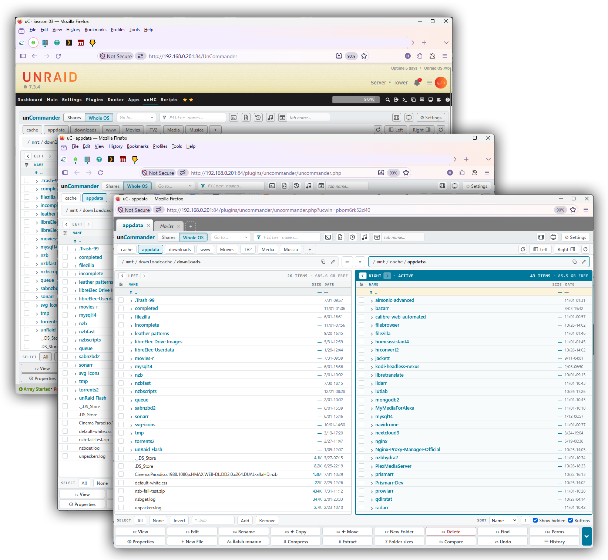](screenshots/views.png)

- **Inside unRAID:** open it from the top menu bar, with unRAID's header and menus around it.
- **In its own tab:** the whole browser window for your files, with its own icon in the tab. Settings → General has the button.
- **As an app:** a minimal application window with no browser bars, or on the iPad, *Share → Add to Home Screen* for an app icon. It looks and feels like a desktop file manager.

Each tab or window keeps its own panes, so you can have several open at once.

---

## 🧭 The basics

[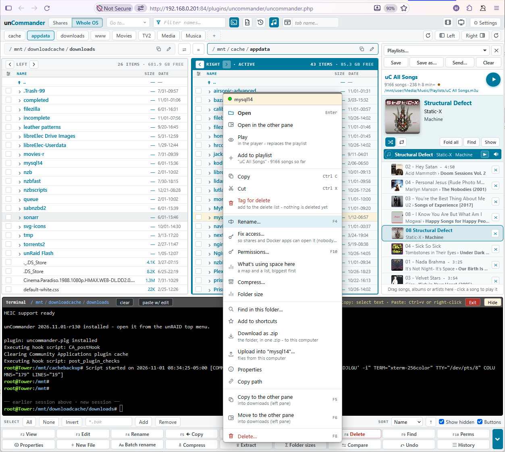](screenshots/main-view2.png)

| Do this | How |
|---|---|
| Open a folder or file | Click its name, or press Enter. On a tablet, tap once to pick the row and tap again to open it. |
| Go up | `..`, Backspace, or tap any part of the path bar. Deeper folders you came from stay greyed in the path, so you can tap straight back into them. |
| Back / Forward | The ‹ › buttons in each pane's header. Each pane has its own history. |
| Switch pane | Click it, or press Tab. The active pane is the source: **Copy →** or **← Copy**. |
| Tick items | The checkboxes, Space or Insert, Shift-click for a range, **All / None / Invert**, or a pattern like `*.srt` with **Add / Remove** |
| Find a name | Just start typing. uC jumps to the first match, or filters the list if you switch the Jump box to filter mode. |
| More actions | Right-click anything, or press and hold on a tablet. The menu has everything that applies to what you clicked. |
| Look inside an archive | Open a .zip, .7z, .rar, .tar.gz (and .bz2 / .xz / .zst), .iso and more just like a folder - click, Enter or double-click. Browse, view, play and copy out; it's read-only, so nothing in it can change. |

**More ways around:**
- **Go to…** opens a panel of every share, disk, pool, Unassigned Devices drive and the flash drive.
- **Shortcuts** are buttons under the top bar for your favourite folders.
- **Folder tree:** an optional caret opens folders right inside the list.
- **One pane** gives the other the full width, for long names.
- **Tabs:** each tab keeps its own panes and name. Tabs can live inside unRAID, in their own browser tab, or in an application window.
- **Whole OS:** a switch in the top bar to go beyond `/mnt` and `/boot` when you really need to.

**What each row tells you:**
- **Columns:** Size, Disk, Date and Mode can each be shown or hidden.
- **Disk** shows which disk(s) or pool an item really lives on. Tap it to open one disk's copy in the other pane.
- **Mode:** an owner other than `nobody:users` shows in amber, so permission problems stand out.

**On the iPad:** open uC in its own tab and use *Share → Add to Home Screen* to make it an app. Press and hold gives you the menu by your finger, and nothing selects page text by accident.

---

## 📂 Copying, moving and jobs

[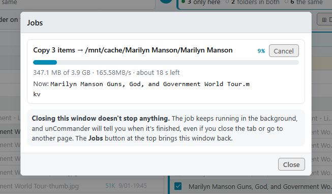](screenshots/copy-progress.png)

- **Copy (F5) and Move (F6)** go to the other pane. You can also **drag and drop** between panes or onto a folder, or use **Ctrl+C / Ctrl+X** then **Ctrl+V**, which shows a Paste window first.
- **The cart:** collect files from several folders, then copy or move them all at once. **Tag for delete** builds a delete list the same way.
- **Upload and download:** drop files from your computer into a pane to upload them, chunked and safe for big files. Download any file, or a whole selection as one zip.
- **Jobs run in the background:**
  - copies use `rsync` at low priority, and a move on the same disk is instant;
  - close the window, the tab, or even the browser, and the job carries on;
  - when it's done you get a row at the top of uC and an unRAID notification;
  - jobs queue one after another, so nothing fights for the disks.
- **Existing files are skipped by default.** You choose per job: skip, replace, or replace only if older. Anything replaced is set aside in the trash first, so it can come back.

### Compare

[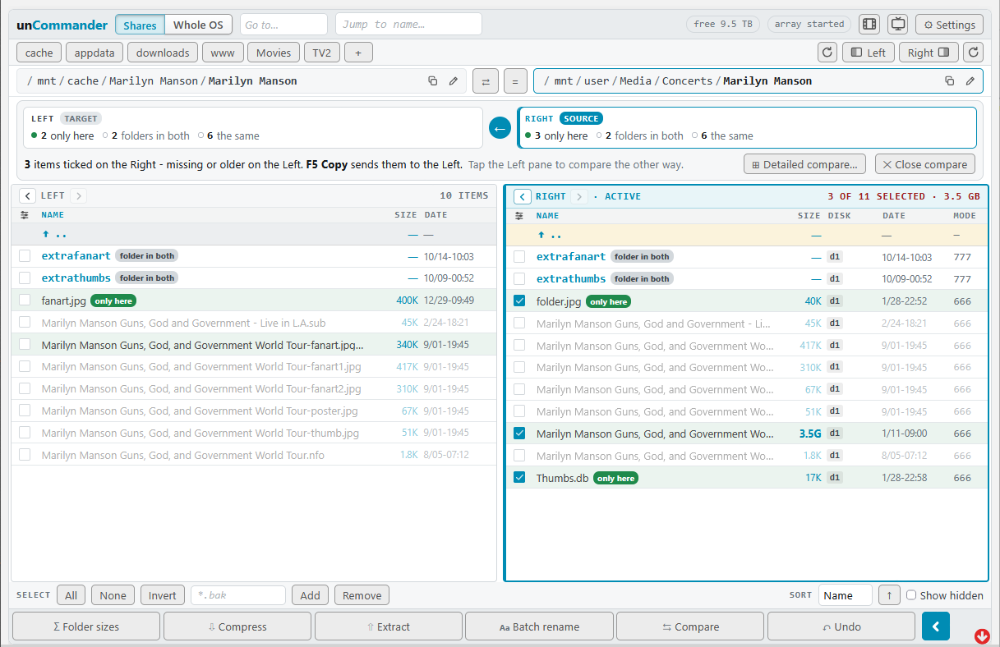](screenshots/compare.png)

**Compare** tags every item in both panes as *only here*, *newer*, *older*, *differs* or *the same*. It ticks what's missing or newer on the active side, so F5 brings the other side up to date. **Detailed compare** goes all the way down through subfolders: one row per difference, an arrow you tap to choose which way it copies, and filters for bulk choices. Compare never deletes anything.

### Batch rename

[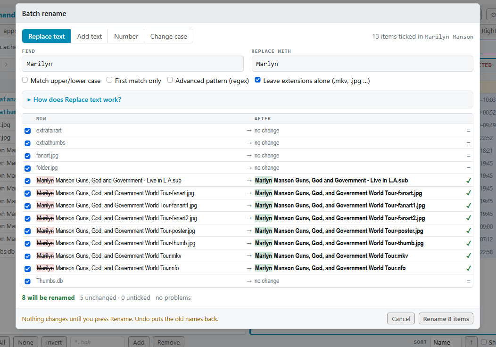](screenshots/batch-rename.png)

Rename the ticked items four ways:
- **Replace** text, plain or as a regular expression;
- **Add** text;
- **Number** them, with patterns like `[name]`, `[n]`, `[date]` and `[folder]`;
- **Change case**.

A live before → after list shows every new name, marks clashes in red, and lets you untick single rows. The whole rename can be undone.

### Also on the menu
- **Compress / Extract:** .zip, .tar.gz, .rar (incl. RAR5), .7z, .tar.bz2/xz/zst and more, with real progress. F3 on an archive lists what's inside.
- **Archives as folders:** go into any archive like a folder, as in Midnight Commander. Pictures, videos, music and text inside open straight away. F5 or drag copies the ticked items out, with Undo, and the right-click menu has *Open as a folder*. It's always read-only. Big .tar.gz files show "Reading…" the first time, and a locked archive asks for its password, which is kept in the server's memory only.
- **Folder sizes:** adds up the ticked folders in the background.
- **Permissions (F10):** owner, group and mode, or unRAID's default in one click.
- **Fix access:** one click so shares and Docker apps can open a file (`nobody:users`).
- **Properties, New file, Copy paths.**

---

## ↩️ Undo, History and the trash

- **Undo** the last change with **Ctrl+Z**, the **Undo** link in each message, or the Undo button.
- **History** lists every change, newest first. Undo any step, or just part of one.
- **Honest about limits:** before anything is replaced, uC tells you exactly how far it can be undone.
- **The trash:**
  - deleting moves items into `.uncommander-trash` at the top of their share or disk, so nothing is copied across disks;
  - open a trash folder to see what each entry holds, when it was deleted and where from;
  - **Restore** puts entries back where they came from.
- **One retention setting:** "Keep deleted items and History for N days" (7 by default). Old items are cleared daily. There's also *Empty the trash now* for when you need the space.
- **Delete for good:** a box in the Delete window skips the trash.
- **Practice mode** (on for new installs) locks everything that changes or removes files, so you can learn uC without risk. Switch it off in Settings when you're ready.

---

## 📝 Viewing and editing

[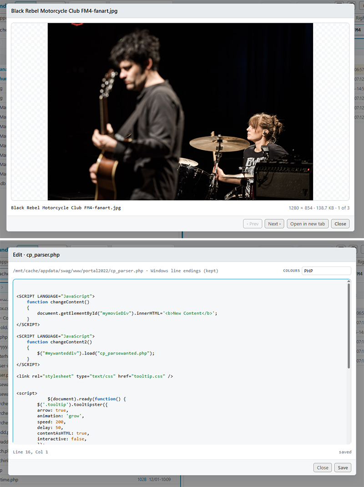](screenshots/viewer.png)

**View and Edit:**
- **View (F2)** shows text with line numbers, pictures fitted to the window (tap for actual size, swipe or ←/→ through the folder), PDFs, and what's inside archives.
- **Edit (F3)** edits text files up to 5 MB. Saving keeps the owner and permissions, and uC warns you if the file changed on disk while you were editing.

**Colour highlighting** covers unRAID `.cfg` files, shell scripts (including `/boot/config/go`), XML, `.nfo` and `.plg`, JSON, YAML and Docker compose, logs (errors in red, warnings in amber), PHP, JavaScript, CSS, Python, Markdown and more.

**Word wrap** is on by default; Alt+Z switches it.

**Find (F9)** searches by name and, optionally, by content. Results open in a pane, in the viewer at the matching line, or in the editor.

---

## 🎬 Pictures, video and music

**Pictures:**
- **Gallery view:** pictures as tiles, with a preview pane that also plays video and audio and peeks into text files.
- **Picture editor:** rotate, flip, crop (with shapes), straighten, resize, and save as JPG, PNG, WebP or GIF. JPG turns are lossless, and you can save as new or replace (undoable).
- **HEIC photos** from iPhones open and convert in any browser.

**Video player:** plays almost any video right in the browser, including on the iPad.
- Sound and picture are converted on the fly when needed, on the CPU, NVIDIA or Intel/AMD.
- Subtitles inside the file or next to it, including PGS/DVD picture subtitles.
- Pick the sound track and adjust sound sync.

### 🎧 Music player

Your music library plays **right inside unCommander** - no Plex, Navidrome or Airsonic to set up. Your music folders become a library of artists and albums with their covers; press Play and keep working while it plays.
- **Player** in the bottom bar with a queue, shuffle, repeat, media keys, and resume where you left off.
- **Music library:** artists and albums with covers, an album strip with Play and Tags, and disc folders (CD1/CD2) handled for you.
- **Tag editor** with a **MusicBrainz** lookup. You review every change before it's written, and every write is checked. It makes folder covers too.
- **Playlists:** **drag and drop** songs, albums or whole artists into the playlist at the side, reorder, and save. **Export** to your apps: **Send** a playlist to **Plex, Kodi** (smart playlists too), **Jellyfin/Emby, Navidrome, Airsonic** or a **USB drive**. Sends are remembered, so they can all be updated in one go later.

---

## 💻 Built-in terminal

unRAID's own web terminal sits under the two panes, as wide as both. It comes with:
- **clickable folder names** to `cd` around;
- a **paste w/ edit** box for long commands;
- **clear** that keeps your scrollback;
- a session that **survives a page reload**;
- an automatic **reconnect** when you come back from another app.

**Hide** keeps it running; **Exit** logs off.

---

## 🧰 Tools

All the tools are one click away: the **Tools** button (🔧) in the top bar opens the list, and it's also in **Settings → Tools**. The Movies and TV tools have their own buttons too. Tools run in the background, remember their last results, and can be tucked away in a pill while you work in the panes.

### Duplicates

[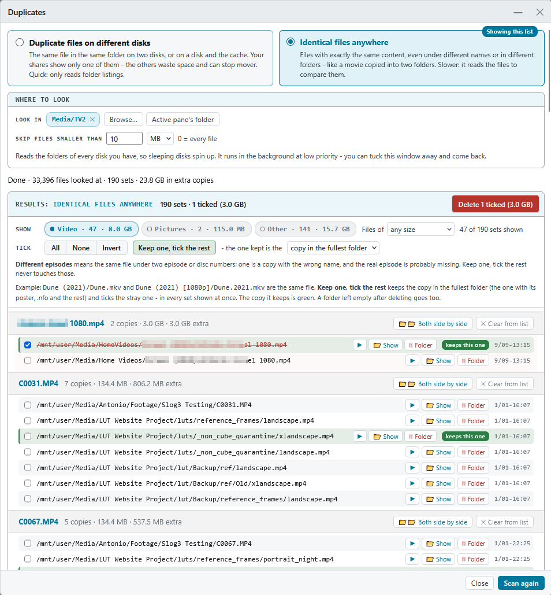](screenshots/duplicates.png)

There are two kinds of check:
- **Duplicate files on different disks** finds the copies your shares hide. When the same file is on two disks, `/mnt/user` only shows one. The other just takes space.
- **Identical files anywhere** compares content byte for byte, whatever the names.

uC can tick for you:
- **Tick the hidden copies**;
- **Keep one, tick the rest**, keeping the copy in the fullest folder, the oldest, the newest, or the one in a folder you pick.

The copy that stays is shown in green. Folders left empty go too, in the same undoable step.

### What's using space

[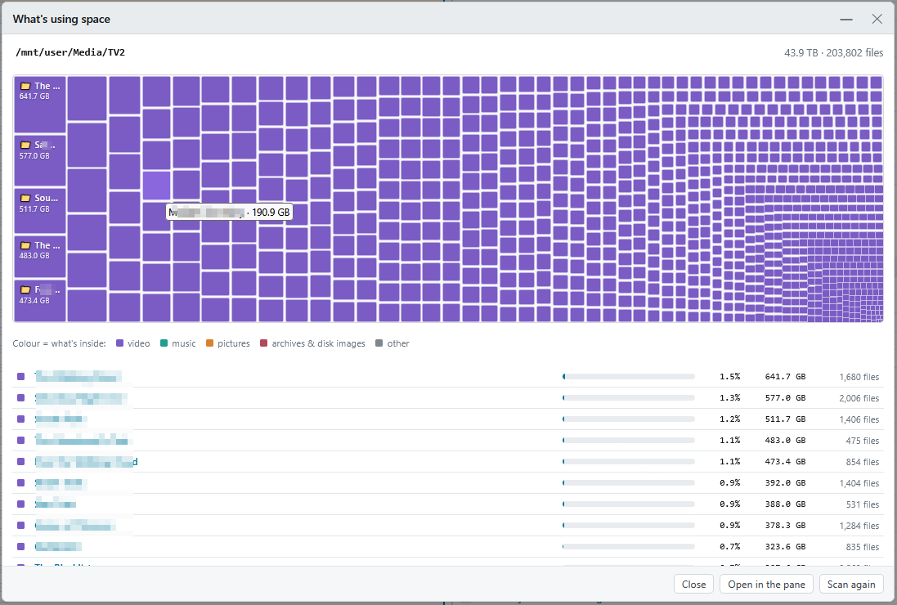](screenshots/usage.png)

A map and a list of any folder, share or whole disk, biggest first, so you can see at a glance where the space went.
- Click a block or a row to go inside; files are coloured by kind (video, music, pictures, archives, other).
- **Open in the pane** takes you to that folder to deal with it. Delete or move things there, then come back with the tool's pill: the map is **updated with what you changed**, without scanning everything again.
- Starts at the active pane's folder, and is on the right-click menu of any folder. Huge folders like appdata work fine.

### Empty folders on disks

[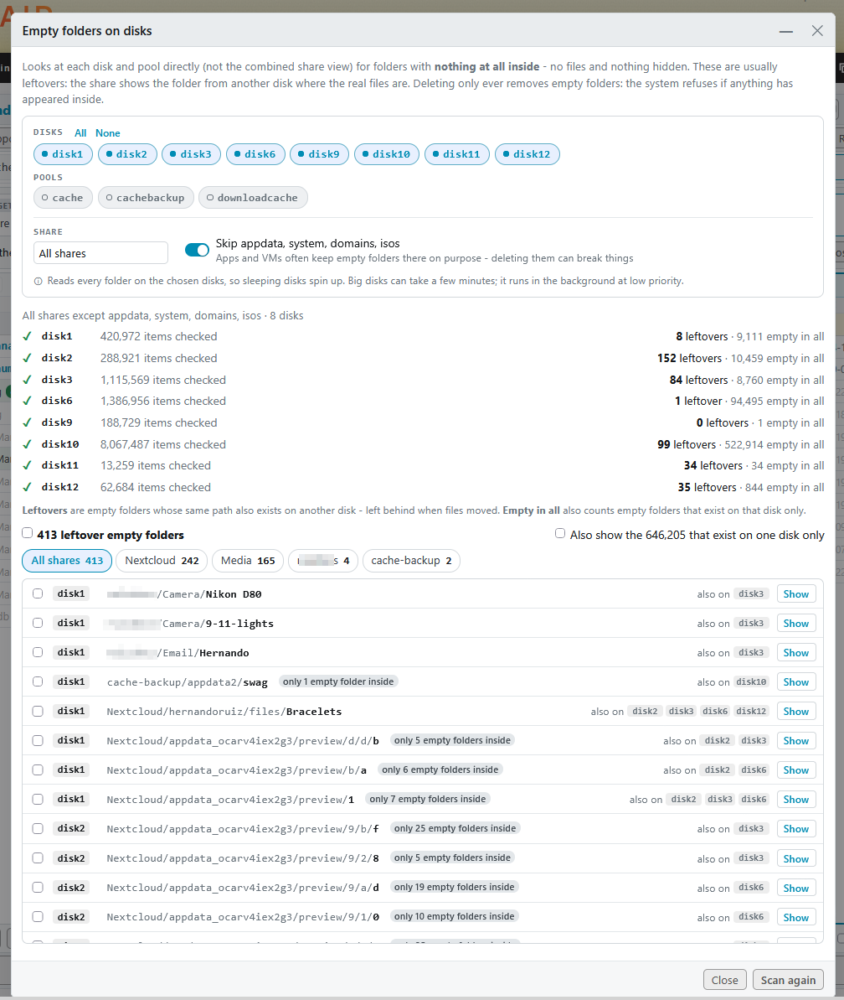](screenshots/tools-empty-folders.png)

This finds empty folders on each disk and pool, which are often leftovers that `/mnt/user` merges away.
- Removal is safe: it uses `rmdir`, so the system refuses anything that isn't empty.
- Undo brings the folders back with the same owner, permissions and dates.

### Movie folders without a video

[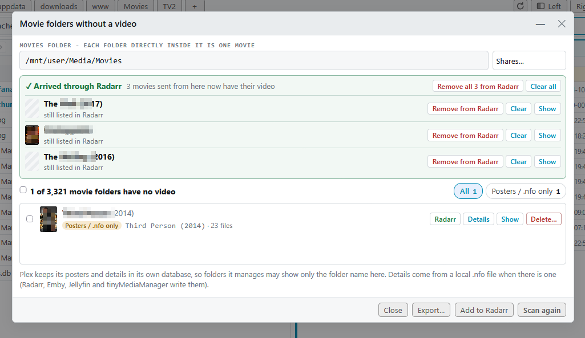](screenshots/tools-movies.png)

Lists the movie folders that have posters, `.nfo` files or samples but no video. It shows details from the `.nfo` (poster, plot, IMDb/TMDb links), exports to CSV, and sends movies back to **Radarr** to download into their existing folders. Movies that come back show up as *✓ Arrived through Radarr*.

### TV shows with missing episodes

[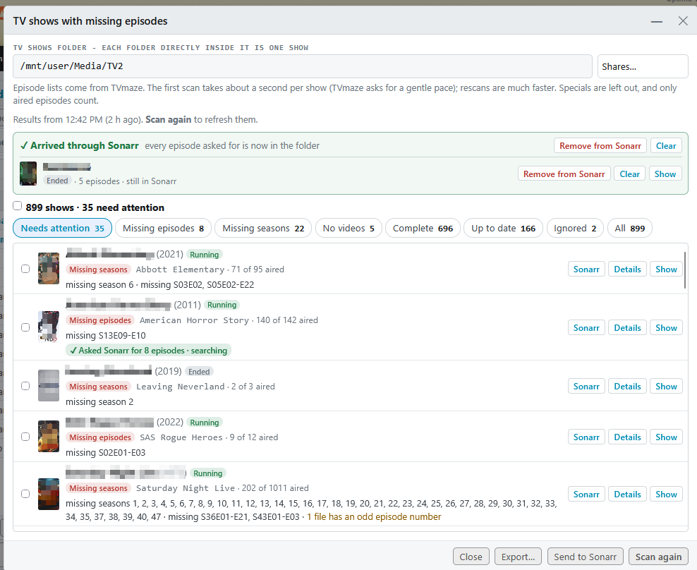](screenshots/tools-tv.png)

Checks your shows against **TVmaze**: which episodes are missing, whether the show has ended or is continuing, and when the next episode airs. It can ask **Sonarr** to get what's missing.

### Music check

Finds:
- albums with missing covers;
- mixed formats;
- missing tracks;
- folders with no songs.

It can make covers, merge discs, rename files to their tags, keep one format, and **ask Lidarr** to fetch what's missing. **Check this playlist** finds songs a playlist can't play.

### Also in Tools
- **Clean up:** see what unCommander itself keeps on your server, and clear it.
- **User Scripts:** run your User Scripts from the top bar.
- **Unassigned Devices:** mount and unmount drives and network shares right from the panes.

---

## 🎨 Make it yours

[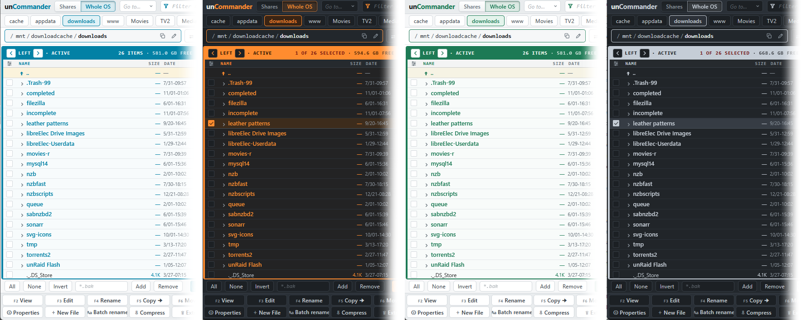](screenshots/themes.png)

**Colours:**
- **Colour themes:** unCommander blue, unRAID orange, Graphite, Mono, Teal, Violet, Forest and **Norton - an homage** to the blue Norton / Midnight Commander screens.
- Each theme has light and dark colours and follows unRAID's own theme (Settings → Display Settings). Edit any colour, or save your own themes.
- **Your own CSS**, with live preview, ready-made examples, a colour picker and a reference of every variable.

**Text size and sounds:** text size is adjustable per device, and soft click sounds are optional.

**Keys and mouse:**
- **F-key layouts:** unCommander's own, *Windows / Midnight Commander* (F2 = Rename, F3 = View, F4 = Edit), or set every key yourself.
- **Typing a name** can jump to it, or filter the list down to the matches. A click on the icon in the Jump box switches between the two.
- **Right-click to tick:** right-click ticks a row, right-drag ticks a run, and holding the button opens the menu (Total Commander style).

**Layout:**
- **Hide the button bar** for more room; the F-keys keep working.
- **Mark what changed lately:** files and folders changed in the last 5, 15 or 60 minutes (or a day) get their names in green.
- **Auto-refresh** shows changes made by other apps as they happen.

[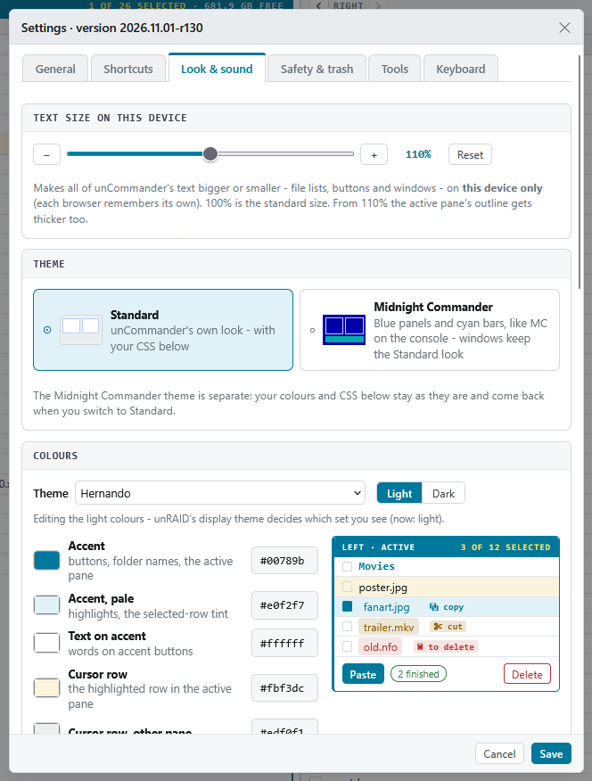](screenshots/settings.png)

---

## 📦 Install

**From Community Applications** (the easy way): open the **Apps** tab, search for **unCommander** and click **Install**.

**Or by hand:**
1. In unRAID, go to **Plugins → Install Plugin**.
2. Paste this link and click **Install**:

   ```
   https://raw.githubusercontent.com/hernandito/unCommander/main/uncommander.plg
   ```

Then open **unCommander** from the unRAID top menu bar. Updates show up in **Plugins → Check for Updates** like any other plugin.

**Requirements:** unRAID 6.12 or later. A few optional parts download by themselves, from their official sources, checked against pinned checksums:
- 7-Zip, for .rar and .7z, at install;
- HEIC support, for iPhone photos, at install;
- ffmpeg, the first time a video needs it.

**Updating?** New versions install over the old one. Your settings, shortcuts, colours, trash and History are all kept.

**Removing it:** **Plugins → unCommander → Remove**. Your settings and any `.uncommander-trash` folders are left in place.

---

## ⌨️ Keyboard

| Key | unCommander layout | Windows / MC layout |
|---|---|---|
| F2 | View | Rename |
| F3 | Edit | View |
| F4 | Rename | Edit |
| F5 / F6 | Copy / Move to the other pane | same |
| F7 | New folder | same |
| F8 or Delete | Delete | same |
| F9 | Find | same |
| F10 | Owner and permissions | same |

| Other keys | |
|---|---|
| ↑ ↓ PgUp PgDn Home End | Move the cursor |
| Enter / Backspace | Open / go up |
| Tab | Switch pane |
| Space, Insert | Tick (Insert also moves down, like MC) |
| Ctrl+A | Tick all |
| Ctrl+C / X / V | Copy, Cut, Paste |
| Ctrl+Z | Undo |
| Menu key, Shift+F10 | The right-click menu |
| Esc | Clear the filter, close a window |

Settings → Keyboard lists every key, and the list follows your layout.

---

## ⚙️ Settings

- **General:**
  - the menu name and whether uC appears in the top menu;
  - opening uC in its own tab, and the tab row;
  - the button bar and *mark what changed lately*;
  - the folder tree, the video and music player, auto-refresh, and touch behaviour.
- **Shortcuts:** your favourite folders.
- **Look & sound:** colour themes, text size, your own CSS, highlighting and sounds.
- **Safety & trash:** Practice mode, the trash, how long to keep deleted items and History, and where History is kept.
- **Tools:** all the tools, and the **Radarr, Sonarr and Lidarr** connections. API keys stay on the server and are never sent to the browser.
- **Keyboard:** the F-key layout, typing jumps or filters, right-click menu or ticks, and the full key list.

Where settings are kept:
- **Per device**, in that browser: the ones that suit one device, such as the button bar, F-keys, typing, right-click and text size.
- **On the server**, the same on every device: everything else.

---

## 🛡️ Safety

- **Only `/mnt` and `/boot`** are reachable unless you switch on the Whole OS view yourself.
- **No accidental self-destruction:** uC refuses to copy or move something onto itself through another view (for example `/mnt/cache/Media/x` onto `/mnt/user/Media`), and won't put a folder inside itself.
- **Existing files are skipped** unless you choose otherwise, and anything replaced goes to the trash first.
- **Practice mode** locks deleting, moving, renaming and permission changes, and the server enforces it too.
- **Little written to the flash drive:** lists, History and ffmpeg live in unCommander's folder on the array. The flash drive holds only your settings and the cached downloads.
- **Array stopped?** uC says so clearly and keeps working where it safely can.

---

## ❓ FAQ

**Does it replace unRAID's built-in file manager (Dynamix File Manager)?**
No. Both work side by side, and nothing of Dynamix File Manager is touched.

**Does it work on an iPad or phone?**
Yes. Tap once to pick and twice to open, press and hold for the menu, and add it to the Home Screen as an app. Phones work too, though a tablet or computer gives the two panes room to breathe.

**Will it spin up my disks?**
Only the disks you actually open, like any file manager. Tools that read every disk (Duplicates, Empty folders) say so before they start, and run at low priority.

**What happens to deleted files?**
They go into `.uncommander-trash` at the top of their share or disk, and stay there for the number of days you set (7 by default). You can restore them any time until then.

**Is my Radarr / Sonarr / Lidarr API key safe?**
It's kept on the server and never sent to the browser.

**Something's wrong. Where do I report it?**
In the [support thread](https://forums.unraid.net/topic/200949-plugin-uncommander-%E2%AD%90-a-powerful-two-pane-file-manager/) on the unRAID forums. Screenshots help a lot.

---

## 🔨 Building from source

The source lives in `src/`, laid out like the paths on the server. Run:

```
UC_VERSION=2026.11.09a \
UC_PLUGIN_URL=https://raw.githubusercontent.com/hernandito/unCommander/main/uncommander.plg \
python3 build.py
```

This writes `uncommander.plg`, one self-contained file with everything inlined. `CHANGES.txt` becomes the change list shown on unRAID's Plugins page.

---

## 📄 License

MIT. See [LICENSE](LICENSE). Developed with assistance from Claude AI.

---

<p align="center"><a href="assets/icon.png">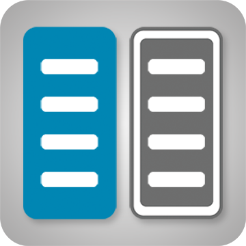</a></p>

Made by **hernandito**. If unCommander saves you time, a ⭐ on the repo and a note in the forum thread are always appreciated.
