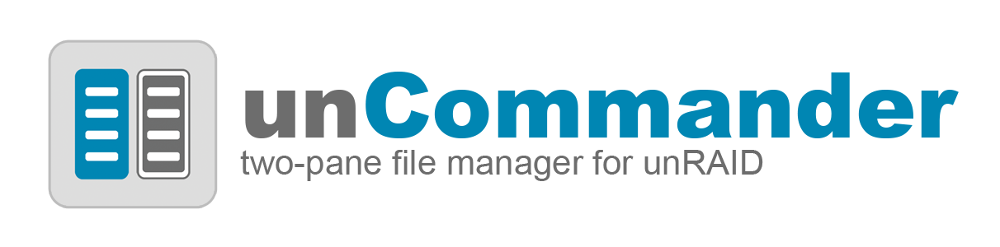
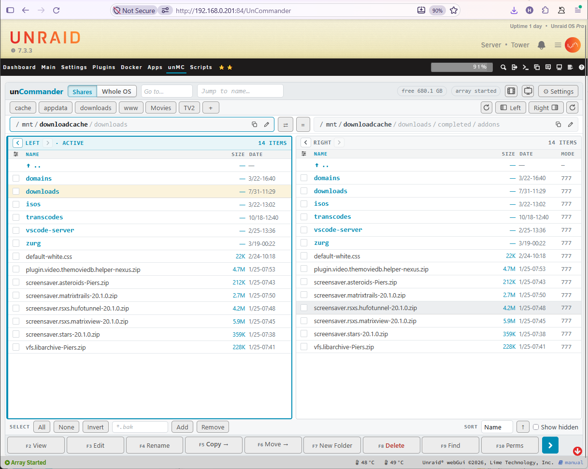
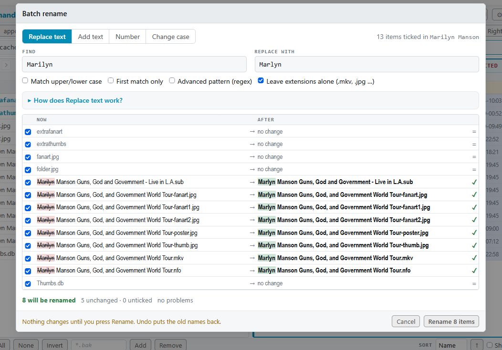
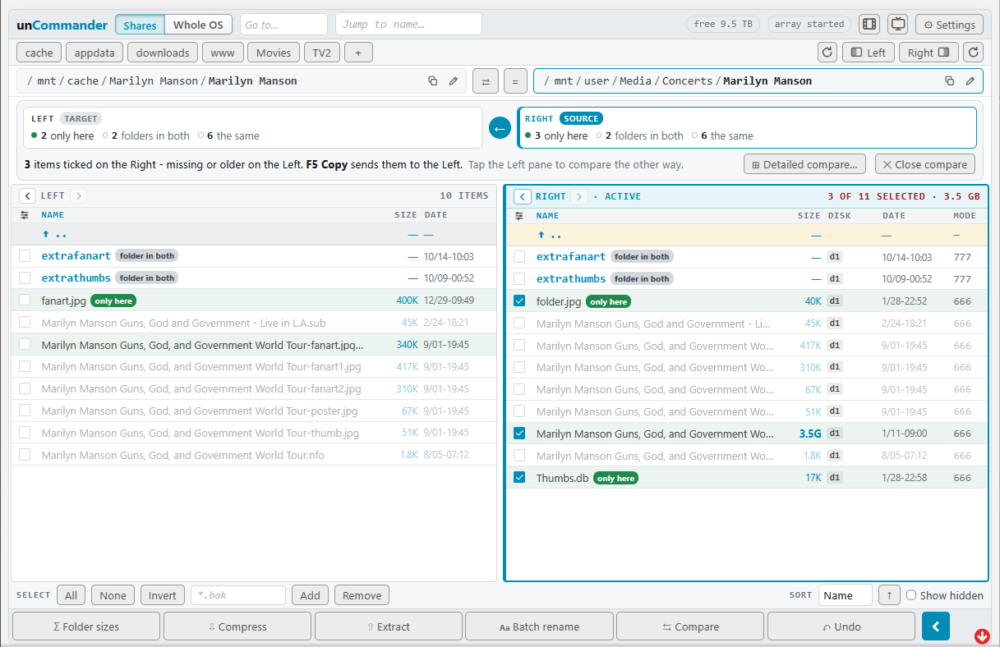
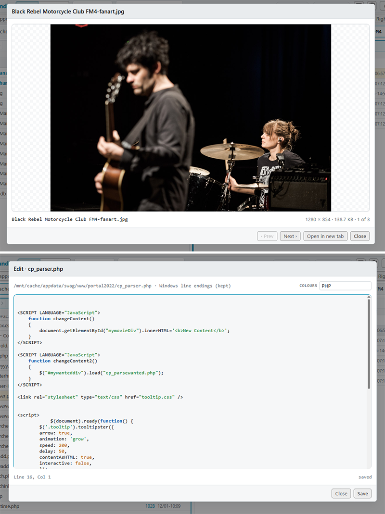
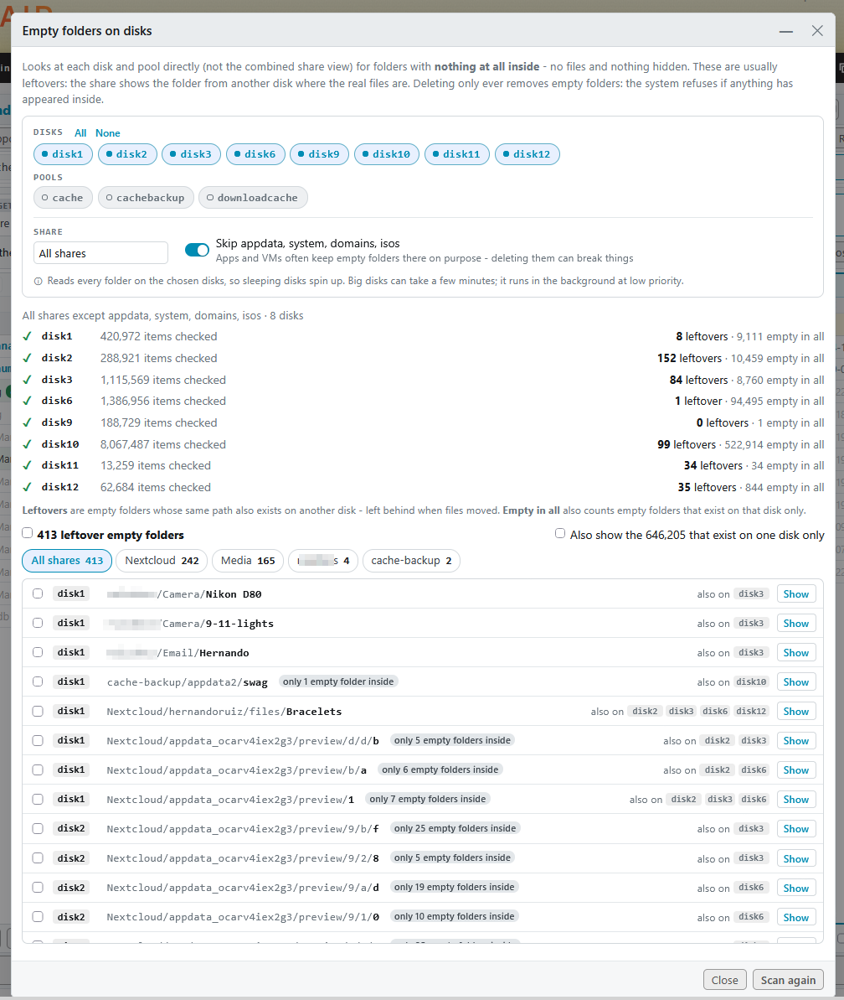
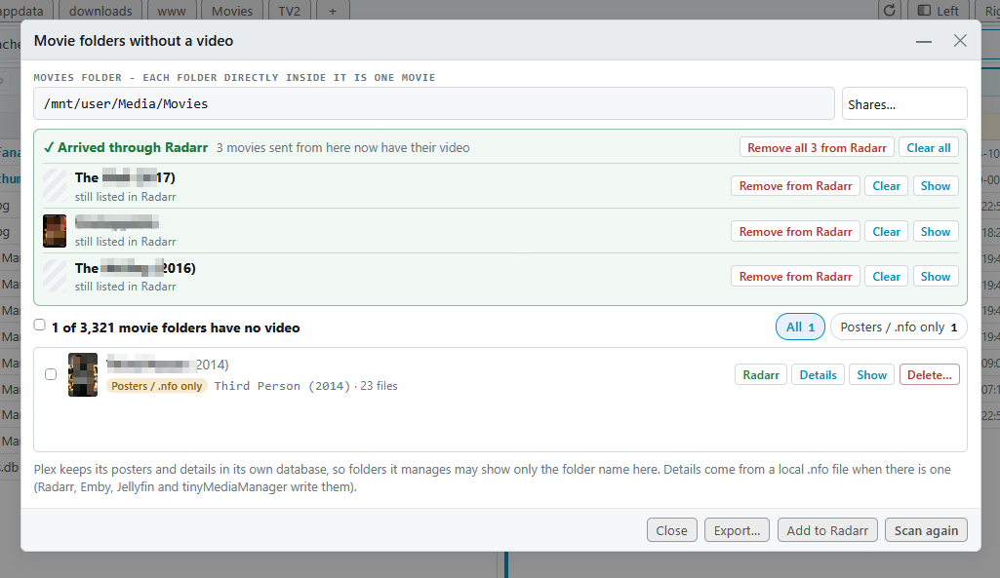
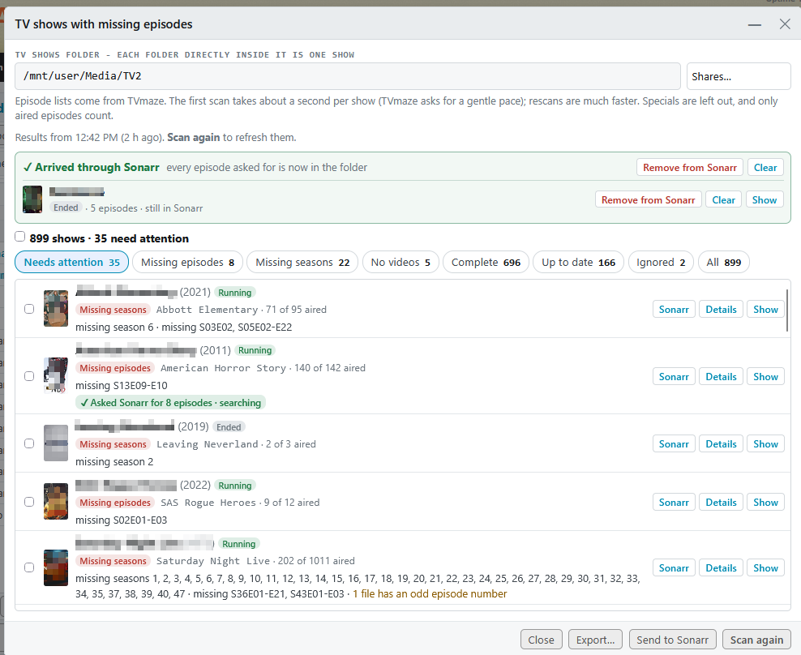
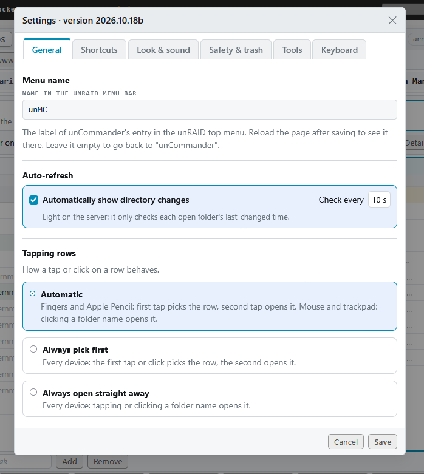

<!-- LOGO: replace logo.png with your own artwork (about 1200 x 300, transparent background works best) -->
<p align="center">
  
</p>

<p align="center">
  <b>A two-pane, Midnight Commander-style file manager for Unraid.</b><br>
  Right in the Unraid web UI - with a mouse, a keyboard, or your fingers on an iPad.
</p>

<p align="center">
  <a href="https://www.buymeacoffee.com/hernandito" target="_blank">
    
  </a>
</p>

---

<!-- SCREENSHOT: the main view - two panes side by side -->


## What is it?

**unCommander** puts a proper file manager into its own tab of the Unraid menu bar. Two folders sit side by side: pick files on one side, press **Copy** or **Move**, and they go to the other side. If you've ever used Midnight Commander, Norton Commander or Total Commander you'll feel at home straight away - and if you haven't, it's just as easy with taps and buttons.

It's built for real Unraid servers: it understands shares, disks and pools, runs big jobs in the background, keeps deleted items in a trash you can restore from, and lets you undo most things. It doesn't touch Unraid's own files and doesn't replace the built-in file manager.

Built with Claude AI.

---

## ✨ Features

### Two-pane navigation
* **Two folders side by side** - the active pane (blue) is the source, the other is the destination.
* **Familiar for Midnight Commander users** - F2 View, F3 Edit, F4 Rename, F5 Copy, F6 Move, F7 New folder, F8 Delete, F9 Find, F10 Permissions, Tab to switch panes.
* **Touch-friendly** - tap to pick a row, tap again to open; every action also has a button. Works great on an iPad.
* **Fast** - folders with thousands of files open instantly; sizes and dates load only for the rows you can see.
* **Clickable path bar**, Back / Forward per pane, shortcut buttons for your favourite folders, and *Jump to name* type-ahead.
* **Show one pane** - hide the left or right pane to give long file names the full width.
* **Refresh a pane** - a small ↻ button for each pane reads its folder again.
* **Whole system view (optional)** - one tap on **Shares | Whole OS** switches the top folder from `/mnt` to `/` so you can browse the whole running system like Midnight Commander on the console, in its own colours (set in the labelled starting CSS). Turn it on in Settings > Safety.
* **Disk column** - see which disk(s) or pool a file in `/mnt/user` really lives on.
* **Auto-refresh (optional)** - folders update by themselves when another program adds or removes files.

### File operations
* **Copy and move** with progress, run as background jobs - close the tab and they keep going; you get a notification when they finish.
* **Delete to trash** - deleted items go to a trash folder on the same share or disk. **Restore** puts them back where they came from; old items are cleaned up after 30 days (adjustable). Or tick **Delete permanently** to free the space straight away.
* **Undo** - rename, move, delete, new folder and even copies can be undone.
* **Safe replacing** - before anything is overwritten you see a list, and the old versions are kept in the trash.
* **Permissions** - set owner and mode, or reset to Unraid's defaults (nobody:users) in one tap.
* **Find** - search by name and by content, then jump to the file, view it, or list the results in a pane.

### Batch rename
* Rename many files at once: **replace text** (with optional regex), **add text**, **numbering** (`[n]`, `[name]`, `[date]`, `[folder]`) or **change case**.
* A **live before → after preview** flags clashes and invalid names before anything happens.
* All-or-nothing: if anything goes wrong, every file keeps its old name. One **Undo** puts them all back.

<!-- SCREENSHOT: batch rename with the live preview -->


### Compress, extract and more
* **Compress** to `.zip` or `.tar.gz`; **extract** `.zip`, `.rar` (incl. RAR5), `.7z`, `.tar.gz/.bz2/.xz/.zst` and more.
* **Folder sizes** - add up the size of folders in the background.
* **Compare** two folders: see what's missing, newer or different, and tick it for copying - or open the **detailed compare**, which includes subfolders and lets you choose the direction per file.

<!-- SCREENSHOT: compare -->


### View and edit
* **Viewer** for text files with line numbers, plus pictures (swipe through a folder) and PDFs.
* **Editor** for config files, scripts, compose files and more - saved in place, keeping owner and permissions.
* **Colour highlighting** for Unraid `.cfg` files, shell scripts, XML / `.nfo`, JSON, YAML, logs, PHP, CSS and more.

<!-- SCREENSHOT: viewer / editor -->


### Tools
* **Empty folders on disks** - finds leftover empty folders on each disk and pool (the ones Unraid's share view hides), and removes them safely. Only truly empty folders are ever removed, and Undo recreates them.
* **Movie folders without a video** - lists movie folders that only have posters, `.nfo` files or samples left, with details, CSV/text export, and delete per folder (to the trash or for good).
* **TV shows with missing episodes** - checks every show folder against its episode list on [TVmaze](https://www.tvmaze.com) (no account or key needed) and sorts shows into Complete, Up to date, Missing episodes, Missing seasons and Needs a look. A season grid shows each episode as in the folder, missing or not aired yet; ignore seasons or whole shows, or mark one complete, and it's remembered. Specials are left out and only aired episodes count. When your files are numbered differently from TVmaze (a season released in two halves, say), the show is checked against Sonarr's numbering instead, and **Details** spells out exactly what's wrong with each show. Wrong match? Search TVmaze yourself - by name, TVmaze link or IMDb id. A show's whole folder can be deleted from Details too.
* **Sonarr integration** - send a show's missing episodes to Sonarr in one tap, one season at a time, or tick several shows. Seasons that are missing in full are also searched as a season pack. A show Sonarr doesn't have is added with its existing folder and only the missing episodes are wanted and searched - your files are left alone. When they arrive, remove the show from Sonarr again, files kept. If Sonarr downloads an episode but won't import it on its own ("matched to series by ID"), unCommander flags it and **Import now** does Sonarr's Manual Import for you.
* **Radarr integration** - send those movies back to Radarr to download again into the same folder. Matches by TMDb / IMDb id or title and year, and asks you when it isn't sure.

<!-- SCREENSHOT: tools -->




### Safety and settings
* **Practice mode** - learn without risk: anything that could delete or change your files is locked.
* **Copy/move guard** - refuses operations that would destroy data, such as copying a disk folder onto the same folder in its share.
* **Midnight Commander theme** - one click in Settings > Look & sound turns the main screen into classic MC: blue panels, cyan bars, yellow ticked files (windows keep the standard look).
* **Keyboard shortcuts** - listed in Settings > Keyboard.
* **Quick tool buttons** - small film and TV buttons next to Settings open the movie and TV tools (switch each off in Settings > Tools).
* **Text size per device** - make all of unCommander's text bigger or smaller (80-140%) without zooming the rest of Unraid; each device and browser remembers its own size.
* **Customise the look** - your own CSS with live preview, ready-made examples, a full colour picker, and simple variables for corners and fonts.
* **Rename the menu tab**, set up shortcuts, sounds, tap behaviour and trash options - saved on the flash drive, the same on every device.

<!-- SCREENSHOT: settings -->


---

## 📦 Installation

### From Community Applications (recommended)
1. Open the **Apps** tab in Unraid.
2. Search for **unCommander** and click **Install**.
3. Reload the page - **unCommander** appears in the Unraid menu bar.

### Manually
1. Go to **Plugins → Install Plugin**.
2. Paste this URL and click **Install**:
   ```
   https://raw.githubusercontent.com/hernandito/uncommander/main/uncommander.plg
   ```

**Requirements:** Unraid 6.12 or newer. Internet access during install is only needed to download the files (and the 7-Zip program used for `.rar` / `.7z`).

**Removing:** Plugins → unCommander → Remove. Your settings (`/boot/config/plugins/uncommander`) and any `.uncommander-trash` folders on your shares are left in place.

---

## ⌨️ Quick reference

| Key | Button | Does |
|---|---|---|
| F2 | View | View a text file, picture, PDF or archive |
| F3 | Edit | Edit a text file |
| F4 | Rename | Rename the item under the cursor |
| F5 | Copy | Copy the ticked items to the other pane |
| F6 | Move | Move the ticked items to the other pane |
| F7 | New Folder | Create a folder |
| F8 / Del | Delete | Move to the trash (or delete for good) |
| F9 | Find | Search by name or content |
| F10 | Perms | Owner and permissions |
| Tab | - | Switch panes |
| Space / Insert | - | Tick / untick |
| Ctrl/Cmd + Z | Undo | Undo the last action |

The **›** button at the end of the button row slides in more: Folder sizes, Compress, Extract, Batch rename, Compare and Undo.

📖 The full guide is in [docs/USER-GUIDE.md](docs/USER-GUIDE.md).

---

## 💬 Support

* Forum thread: *(link coming soon)*
* Bugs and ideas: [GitHub Issues](https://github.com/hernandito/uncommander/issues)

## 📄 License

GPL-3.0 - see [LICENSE](LICENSE).

7-Zip (`7zzs`) is downloaded at install from the [official 7-Zip releases](https://github.com/ip7z/7zip/releases) and is © Igor Pavlov, under its own license.
