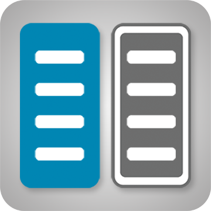

<p align="center"></p>

# 📖 unCommander User Guide

Everything unCommander (uC) can do, and how to do it. New here? The [README](../README.md) has the overview and screenshots; this guide is the reference you come back to.

> **Tip:** most things in uC are also on the **right-click menu** (press and hold on an iPad). When in doubt, right-click it.

---

## Contents

**Getting around**
- [The screen at a glance](#the-screen-at-a-glance)
- [Opening folders and files](#opening-folders-and-files)
- [Moving around: path bar, Back, Go to, shortcuts](#moving-around)
- [Ticking items](#ticking-items)
- [Finding a name: jump or filter](#finding-a-name-jump-or-filter)
- [Columns, disks and permissions](#columns-disks-and-permissions)
- [Tabs and windows](#tabs-and-windows)
- [Using uC on an iPad](#using-uc-on-an-ipad)

**Working with files**
- [Copy and move](#copy-and-move)
- [Jobs: work in the background](#jobs-work-in-the-background)
- [The cart and Tag for delete](#the-cart-and-tag-for-delete)
- [Upload and download](#upload-and-download)
- [Rename and batch rename](#rename-and-batch-rename)
- [Delete, the trash and Restore](#delete-the-trash-and-restore)
- [Undo and History](#undo-and-history)
- [Compare two folders](#compare-two-folders)
- [Archives: compress, extract, and open like a folder](#archives)
- [Folder sizes](#folder-sizes)
- [Owner and permissions, Fix access](#owner-and-permissions-fix-access)
- [Find](#find)

**Looking at things**
- [View and Edit](#view-and-edit)
- [Pictures: Gallery and the picture editor](#pictures-gallery-and-the-picture-editor)
- [Video player](#video-player)
- [Music player, library and playlists](#music-player-library-and-playlists)
- [Built-in terminal](#built-in-terminal)

**Tools**
- [Opening the tools](#opening-the-tools)
- [What's using space](#whats-using-space)
- [Duplicates](#duplicates)
- [Empty folders on disks](#empty-folders-on-disks)
- [Movie folders without a video (Radarr)](#movie-folders-without-a-video)
- [TV shows with missing episodes (Sonarr)](#tv-shows-with-missing-episodes)
- [Music check (Lidarr)](#music-check)
- [Clean up, User Scripts, Unassigned Devices](#clean-up-user-scripts-unassigned-devices)

**Making it yours**
- [Colour themes and your own CSS](#colour-themes-and-your-own-css)
- [Keys, typing and the right mouse button](#keys-typing-and-the-right-mouse-button)
- [Layout options](#layout-options)
- [Settings, tab by tab](#settings-tab-by-tab)
- [Keyboard reference](#keyboard-reference)

**Safety and housekeeping**
- [Practice mode](#practice-mode)
- [What uC protects you from](#what-uc-protects-you-from)
- [Whole OS view](#whole-os-view)
- [Where uC keeps things](#where-uc-keeps-things)
- [Troubleshooting](#troubleshooting)

---

# Getting around

## The screen at a glance

From top to bottom:

- **Top bar:** the **Shares | Whole OS** switch (if you turned it on), **Go to…**, the **Jump** box, and buttons for the terminal, the Tools, Movies and TV tools, History, the music player, tabs, and **Settings**.
- **Shortcuts row:** your favourite folders as buttons, ↻ to refresh a pane, and **Left | Right** to show or hide a pane.
- **Path bars:** where each pane is. ⇄ swaps the two panes, **=** makes the other pane show the same folder.
- **Two panes:** the **active** pane has the coloured outline. It's the *source* for Copy and Move; the other pane is the *destination*.
- **Selection row:** All / None / Invert, a pattern box with Add / Remove, and Sort.
- **Function keys:** F2-F10 as buttons. The **›** at the end slides in a second row (Folder sizes, Compress, Extract, Batch rename, Compare, Undo).

## Opening folders and files

- **Click a name** (or press **Enter**) to open a folder or file.
- On a tablet, **tap once** to pick the row and **tap again** to open it. Settings → General → *Tapping rows* changes this.
- Files open in the right place: text in the viewer, pictures in the picture viewer, video and music in their players, archives as folders.
- **`..`** at the top of the list (or **Backspace**) goes up a level.

## Moving around

- **Path bar:** tap any part to jump there. Folders you came back up from stay greyed, so you can tap straight back down. Tap the pencil (or the empty space) to type a path; the copy icon copies it.
- **Back / Forward:** the **‹ ›** buttons in each pane's header work like a browser's. Each pane keeps its own history, even across reloads.
- **Go to…** lists every share, disk, pool, Unassigned Devices drive and the flash drive.
- **Shortcuts:** **＋** in the shortcuts row adds the active folder. Rename, reorder or remove them in Settings → Shortcuts.
- **Folder tree** (Settings → General): a caret next to each folder opens it in place, inside the list.
- **One pane:** tap **Left** or **Right** to hide that pane and give the other the full width. Tap it again to bring it back. The hidden pane still counts as the destination.
- **The top is `/mnt`:** it holds `user` (all your shares), each disk and pool, and Unassigned Devices. The flash drive (`/boot`) is in **Go to…**.

## Ticking items

Most actions work on the **ticked** items, or on the row under the cursor when nothing is ticked.

- Click the **checkbox**, or press **Space** or **Insert** (Insert also moves down, like Midnight Commander).
- **Shift-click** ticks a range. **Ctrl+A** ticks everything.
- **All / None / Invert** in the selection row.
- **By pattern:** type `*.srt` or `*sample*` in the pattern box and press **Add** (Enter) or **Remove** (Shift+Enter).
- **Right mouse button** can tick instead of opening the menu - see [Keys, typing and the right mouse button](#keys-typing-and-the-right-mouse-button).
- Ticks are remembered: leave uC and come back, and each pane's ticks and cursor are still there.

## Finding a name: jump or filter

Just start typing while uC has the focus (or tap the **Jump** box on a tablet).

- **Jump** mode moves the cursor to the first match; ↑ ↓ go to the other matches and Enter opens it.
- **Filter** mode hides everything that doesn't match. **Esc** clears it.
- Click the icon inside the Jump box to switch between the two; Settings → Keyboard sets the default.

## Columns, disks and permissions

- The **sliders icon** at the top left of each pane's column titles shows or hides **Size, Disk, Date** and **Mode**. Each pane remembers its own choice.
- **Disk** (in `/mnt/user` and search results) shows which disk(s) or pool each item really lives on: `d1`, `d2 d5`, `cache`, or `d1 +2`. **Tap it** to see what each disk holds and open one disk's copy in the other pane.
- **Mode** shows permissions; an owner other than `nobody:users` is shown in **amber** so access problems stand out.
- **Sort** by name, size, date or extension with the Sort menu; the arrow flips the order.

## Tabs and windows

- The **tabs** button in the top bar opens a new tab with its own two panes; tabs can have names.
- **In its own browser tab:** Settings → General has the button. uC fills the whole window, with its own tab icon.
- **As an app window:** a minimal window with no browser bars, like a desktop file manager.
- Each tab and window keeps its own panes, so you can have several open at once.

## Using uC on an iPad

- Open uC in its own tab, then **Share → Add to Home Screen** for a full-screen app with its own icon.
- **Tap** to pick, **tap again** to open, **press and hold** for the right-click menu.
- **Swipe** left and right through pictures in the viewer.
- Nothing selects page text by accident, and the menus open by your finger.

---

# Working with files

## Copy and move

- **F5 Copy** and **F6 Move** send the ticked items to the other pane. The active pane is always the source: the buttons show **Copy →** or **← Copy**.
- **Drag and drop:** drag items onto the other pane or onto a folder. Dragging out of an archive always copies.
- **Ctrl+C / Ctrl+X, then Ctrl+V** (or Copy / Cut / Paste on the menu) - Paste shows what will happen before it starts.
- **Files that already exist** are **skipped** unless you choose otherwise. Each job lets you pick: Skip, Replace, or Replace if older.
- **Anything replaced is set aside in the trash first,** so it can come back. Before replacing, uC tells you exactly how far it can be undone.
- A move on the same disk is instant. Between disks, uC copies and then removes the originals.

## Jobs: work in the background

- Copies, moves, compress/extract and permission changes run as **background jobs** at low priority, one after another, so nothing fights for the disks.
- A progress window shows the job and anything queued behind it, with **Cancel**.
- **Continue in background**, close the tab, or even close the browser: the job carries on. When it ends you get a row at the top of uC (on every device) and an unRAID notification. Settings → General → *When a job finishes* can switch the notification off.
- The **Jobs** button in the top bar brings the window back.
- Jobs survive a closed tab, but not a server reboot.

## The cart and Tag for delete

- **Add to cart** (right-click menu) collects files and folders from as many places as you like. Then copy or move the whole cart in one job.
- **Tag for delete** does the same for deleting: build up a list as you browse, then delete it all at once, with Undo.

## Upload and download

- **Upload:** drop files from your computer onto a pane. Big files go up in chunks, and the progress shows in the pane.
- **Download:** right-click a file and choose Download. Several ticked items, or a folder, come down as one zip.

## Rename and batch rename

- **F4 Rename** (F2 in the Windows/MC layout) renames the item under the cursor.
- **Batch rename** (second F-key row, or the right-click menu) renames all the ticked items at once, four ways:
  - **Replace text** - plain, or as a regular expression;
  - **Add text** - at the start or end;
  - **Number** - with a pattern using `[n]`, `[name]`, `[date]` and `[folder]`, a start number, digits, and order by name or date;
  - **Change case**.
- A live **Now → After** list shows every new name. Clashes and invalid names turn red, and you can untick single rows.
- It's all-or-nothing: if any item can't be renamed, every item keeps its old name. Swaps (a ↔ b) and case-only changes work. **Undo** puts all the old names back.

## Delete, the trash and Restore

- **F8** or **Delete** moves the ticked items to the **trash**: a `.uncommander-trash` folder at the top of their share or disk. Nothing is copied across disks, so it's instant.
- **Open a trash folder** to see each entry: what it holds, when it was deleted and where from. Tick entries and press **Restore** to put them back where they came from.
- **Delete for good:** a box in the Delete window skips the trash.
- **How long things are kept:** Settings → Safety & trash → *Keep deleted items and History for (days)*, 7 by default. Every day at 4:17 am older items are removed for good. **Empty the trash now** frees the space straight away.
- The Whole OS view (outside `/mnt` and `/boot`) has no trash: deleting there is for good.

## Undo and History

- **Ctrl+Z**, the **Undo** link in each message, or the **Undo** button undoes the last change.
- The **History** button opens the full list of changes, newest first. **Undo any step, or just part of one** - even days later.
- What can be undone:
  - renames and batch renames;
  - moves (the items move back, and anything they replaced returns);
  - deletes to the trash;
  - copies (the new copies go to the trash, and any files they replaced come back);
  - new folders (removed if still empty);
  - replacing a picture from the picture editor;
  - edits made by tools, such as Duplicates and Empty folders.
- Permission changes, permanent deletes, text editor saves and Compress / Extract can't be undone; for deletes and replaced files, uC says so before it starts.
- History lives in uC's own folder on the array, and forgets steps after the same number of days as the trash.

## Compare two folders

1. Open a folder in each pane.
2. Make the side you want to copy **from** active, and press **Compare** (second F-key row).
3. Every item in both panes is tagged: **only here**, **newer**, **older**, **differs** (same date, different size), **folder in both** or **the same**.
4. The active side's items that are missing or newer on the other side are ticked. A bar above the panes says which way **F5 Copy** will go; tap the other pane to flip it.
5. Press F5. Compare re-runs itself after the copy.

**Detailed compare** (the button on the Compare bar) goes all the way down through subfolders. Each difference is one row with an arrow you tap to choose: → copy right, ← copy left, = leave alone. Filters (Differences, Only left, Only right, Newer left/right…) and "for every row shown" buttons make bulk choices quick. One button runs it all as background copies. **Compare never deletes anything.**

## Archives

**Open an archive like a folder.** Click, Enter or double-click a .zip, .7z, .rar, .tar.gz (and .bz2 / .xz / .zst) or .iso, or use *Open as a folder* on the right-click menu.
- A strip under the pane header and a pill in the path bar show you're inside one, with **✕ Close archive** to go back out.
- Pictures, videos, music and text inside open straight away.
- **Copy out** with F5, drag, or Copy/Paste. It runs as a normal job, with Skip/Replace and Undo.
- Archives are **read-only**: Delete, Rename, Move and New folder are switched off inside one.
- A big .tar.gz shows *Reading…* the first time; after that every folder opens instantly.
- A **locked archive** asks for its password once. It's kept in the server's memory only, never on the flash drive, until the next reboot.
- An archive inside an archive opens once you've copied it out. Files over 2 GB need copying out before they play.

**Compress** packs the ticked items into a .zip or .tar.gz, in this folder or the other pane. Photos and videos are stored rather than squeezed by default, and you can have the originals moved to the trash afterwards.

**Extract** unpacks the archive under the cursor - .zip, .rar (including RAR5), .7z, .tar.* and more - into a new folder named after it, here or in the other pane. Existing files are skipped unless you choose Replace, and you can have the archive (every part of a multi-part one) moved to the trash afterwards.

Both run as jobs with a real progress bar.

## Folder sizes

**Folder sizes** (second F-key row, or the right-click menu) adds up the ticked folders - or the one under the cursor - in the background. A window shows each running total; the results appear in the Size column (in blue) and in the selection count until you leave the folder. Sizes use decimal units (1 GB = 1,000,000,000 bytes), like unRAID.

## Owner and permissions, Fix access

- **F10** sets the owner, group and mode of the ticked items, optionally for everything inside, or applies **unRAID's default** (nobody:users, folders 777, files 666) in one click.
- **Fix access** (right-click menu) is the one-click version for "my Docker app or share can't open this file".
- Permission changes can't be undone, so check them before you confirm.

## Find

**F9** opens Find:
- search **by name** (patterns like `*.mkv` work), and optionally **by content**;
- start from the current folder or anywhere;
- results list in the window; **Go to file**, **View** (opens at the matching line, highlighted), **Edit**, or **List in pane** to work with them like a normal folder.

---

# Looking at things

## View and Edit

- **F2 View** (F3 in the Windows/MC layout) shows:
  - text with line numbers and colour highlighting;
  - pictures, fitted to the window - tap for actual size, ← → or swipe through the folder;
  - PDFs, with *Open in new tab* for full screen;
  - what's inside an archive.
- **F3 Edit** (F4 in the Windows/MC layout) edits text files up to 5 MB. Saving keeps the owner and permissions, and uC warns you if the file changed on disk while you were editing.
- **Colour highlighting** covers unRAID `.cfg` files, shell scripts (including `/boot/config/go`), XML, `.nfo` and `.plg`, JSON, YAML and Docker compose, logs (errors red, warnings amber), PHP, JavaScript, CSS, Python, Markdown, Dockerfiles and diffs. The **Colours** menu in the window changes the type and is remembered per kind of file. Switch highlighting off in Settings → Look & sound.
- **Word wrap** is on by default; **Alt+Z** switches it.

## Pictures: Gallery and the picture editor

- **Gallery view** (the view switch in the pane header) shows pictures as tiles, with a **preview pane** that also plays video and audio and peeks into text files.
- **Picture editor** (Edit on a picture): rotate, flip, crop (with shapes), straighten and resize, then save as JPG, PNG, WebP or GIF. JPG turns are lossless. **Save as new** or **Replace** - replacing can be undone.
- **HEIC photos** from iPhones open and convert in any browser.

## Video player

Plays almost any video in the browser, including on the iPad:
- sound and picture are converted on the fly when the browser can't play them, on the CPU or on an NVIDIA or Intel/AMD GPU;
- **subtitles** inside the file or next to it, including PGS/DVD picture subtitles;
- pick the **sound track**, and nudge **sound sync**.

ffmpeg is downloaded the first time a video needs it (checked against a known checksum) and kept in uC's folder on the array.

## Music player, library and playlists

**The player** sits in the bottom bar: a queue, shuffle, repeat, media keys, and it remembers where you left off. Keep browsing and working while it plays.

**The library:** open the music view (the ♫ button) and your music folders become artists and albums with their covers. Each album has a strip with **Play** and **Tags**. Multi-disc albums (CD1, CD2…) are handled as one.

**Tag editor:** edit tags for a song or a whole album, with a **MusicBrainz** lookup. You review every change before it's written, and every write is checked afterwards. It can make the folder cover too.

**Playlists:**
1. Open the playlist panel at the side.
2. **Drag and drop** songs, albums or whole artists into it, reorder, and save.
3. **Send** it to your apps: **Plex**, **Kodi** (smart playlists too), **Jellyfin/Emby**, **Navidrome**, **Airsonic**, or a **USB drive**.

Sends are remembered, so you can update them all in one go later. **Check this playlist** finds songs a playlist can't play.

## Built-in terminal

The terminal button opens unRAID's own web terminal under the panes, as wide as both.
- **Click a folder name** in the terminal to `cd` there.
- The **paste w/ edit** box is for long commands you want to check first.
- **clear** keeps your scrollback; the session survives a page reload and reconnects by itself when you come back from another app.
- **Hide** keeps it running; **Exit** logs off.

---

# Tools

## Opening the tools

- The **Tools** button (wrench) in the top bar opens the list; the same list is in Settings → Tools.
- The **Movies** and **TV** tools also have their own buttons. Each one can be hidden with its *Display icon in UI* box.
- Tools run in the background and remember their last results, on any device, for a day.
- **Tuck a tool away:** the — button (or **Show** / **Open in the pane** on a row) tucks it into a purple **pill** at the top and leaves it running. Tap the pill to bring it back exactly as it was. Only ✕ or Close closes it.

## What's using space

A **map** and a **list** of any folder, share or disk, biggest first.
- Start it from the Tools list (it uses the active pane's folder) or from the right-click menu of any folder.
- Click a block or row to go inside. Colours show the kind of file: video, music, pictures, archives, other.
- **Open in the pane** takes you to that folder. Delete or move things there, then tap the pill to come back: the map is **updated with what you changed**, without scanning again.
- Huge folders like appdata are fine.

## Duplicates

Two kinds of check:
- **Duplicate files on different disks** - the same file on two disks, where `/mnt/user` shows only one and the other just takes space.
- **Identical files anywhere** - content compared byte for byte, whatever the names.

uC can tick for you: **Tick the hidden copies** (in every set), or **Keep one, tick the rest** - keeping the copy in the fullest folder, the oldest, the newest, or the one in a folder you pick. The copy that stays shows in green. Deleting is one undoable step, and folders left empty go too.

## Empty folders on disks

Finds folders with nothing at all inside on each disk and pool - usually leftovers that `/mnt/user` merges away.
- **Leftovers** are empty folders whose same path also exists on another disk; a box also shows ones that exist on one disk only.
- appdata, system, domains and isos are skipped by default.
- Deleting uses `rmdir`, which the system refuses for anything that isn't empty. **Undo** brings the folders back with the same owner, permissions and dates.
- It reads every folder on the chosen disks, so sleeping disks spin up; it runs at low priority.

## Movie folders without a video

Pick your movies folder (each folder directly inside is one movie). uC lists the folders with **no video**, grouped as *Posters / .nfo only*, *Empty*, *Sample only* and *Other files*.
- **Details** shows the poster, plot, rating and IMDb/TMDb links from a local `.nfo`, plus the files inside.
- **Export** the list as CSV or text.
- **Delete…** moves folders to the trash (or deletes for good, with a confirmation), and can remove the movie from Radarr too.
- **Add to Radarr** sends movies back to Radarr to download into their existing folders. When they arrive, they show in the green **✓ Arrived through Radarr** panel, with **Remove from Radarr** and **Clear**.

**Setting up Radarr:** Settings → Tools → Radarr. Enter the address, port, optional URL base and API key, then **Test connection**. uC pairs Radarr's root folders with the same folders on this server (from the container's Docker mappings - edit if wrong), and you pick the quality profile and whether to search right away. The API key stays on the server and is never sent to the browser.

## TV shows with missing episodes

Pick your TV folder (each folder directly inside is one show) and press Scan. Episode lists come from **TVmaze** (no account needed). Specials, extras and samples are skipped, and only episodes that aired 3 or more days ago count.

Results are grouped: **Missing episodes**, **Missing seasons**, **Needs a look** (numbering that doesn't line up), **No videos**, **Not matched**, **Couldn't check**, **Complete** (ended, all there) and **Up to date** (running, all aired so far there). Each show says whether it has **Ended** or is **Running**.

- **Details** shows a season grid (green = there, red = missing, dashed = not aired yet), with **Ignore season**, **Ignore this show** and **Mark as complete**. A *What's wrong* box explains problems in plain words.
- **Wrong show?** Search TVmaze from Details, or paste a TVmaze link, an IMDb id (`tt1234567`) or `tvdb:12345`. Your choice is remembered.
- **Export** lists the missing episodes as CSV or text. Nothing in your folders is ever changed by the scan.

**Sonarr:** set it up in Settings → Tools, like Radarr. Then the **Sonarr** button on a show (or **Get season N**, or tick several and **Send to Sonarr**) asks Sonarr for just the missing aired episodes. Shows Sonarr doesn't have are added with their existing folder. Whole missing seasons are also searched as season packs. If a download is stuck waiting for import, **Import now** does Sonarr's Manual Import for you. Shows whose episodes all arrived appear in **✓ Arrived through Sonarr**.

## Music check

Finds albums with **missing covers**, **mixed formats**, **missing tracks**, and folders with **no songs**. It can make covers, merge discs, rename files to their tags, keep one format, and **ask Lidarr** to fetch what's missing (set Lidarr up in Settings → Tools).

## Clean up, User Scripts, Unassigned Devices

- **Clean up** shows what uC itself keeps on your server (caches, old scans, downloads) and lets you clear it.
- **User Scripts:** with the User Scripts plugin installed, run your scripts from uC's top bar.
- **Unassigned Devices:** mount and unmount drives and network shares right from the panes (Go to… lists them).

---

# Making it yours

## Colour themes and your own CSS

Settings → Look & sound:
- **Colour themes:** unCommander blue, unRAID orange, Graphite, Mono, Teal, Violet, Forest, and **Norton - an homage**. Each has light and dark colours and follows unRAID's own theme (Settings → Display Settings in unRAID).
- **Edit any colour** with the colour picker, or save your own theme. **Undo my changes** goes back to the theme as it came.
- **Your own CSS** is applied over uC's, with live preview, ready-made examples, a colour picker and a list of every variable.
- **Text size on this device** (80%-140%) scales all of uC's text, rows and columns, separately on each device.
- **Sounds:** soft clicks for buttons, opening folders and errors, with volume and per-group switches.

## Keys, typing and the right mouse button

Settings → Keyboard:
- **F-key layout:** unCommander's own, **Windows / Midnight Commander** (F2 Rename, F3 View, F4 Edit), or set every key yourself.
- **Typing a name** jumps to it or filters the list.
- **Right mouse button:** open the menu, or **tick** (right-drag ticks a run, and holding the button opens the menu - Total Commander style).

## Layout options

Settings → General:
- **Hide the button bar** for more room; the F-keys still work.
- **Mark what changed lately:** names of files changed in the last 5, 15 or 60 minutes (or a day) turn green.
- **Auto-refresh** shows changes made by other apps as they happen, every 5-60 seconds. It checks a folder's change time only, so it's cheap, and pauses while the tab is hidden or a window is open.
- **Folder tree**, the **video and music player**, **tapping rows**, and whether uC is in unRAID's top menu (and under what name).

## Settings, tab by tab

| Tab | What's there |
|---|---|
| **General** | uC in unRAID (menu name, own tab, tab row), folder tree, video and music, tapping rows, when a job finishes, auto-refresh, About |
| **Shortcuts** | Your favourite folders: add, rename, reorder, remove |
| **Look & sound** | Colour themes, text size on this device, your own CSS, highlighting, sounds |
| **Safety & trash** | Practice mode, Whole system view, Trash & History (days kept, uC's folder, Empty the trash now) |
| **Tools** | All the tools, their *Display icon in UI* boxes, and the Radarr, Sonarr and Lidarr connections |
| **Keyboard** | F-key layout, typing (jump or filter), right mouse button, and every shortcut |

Settings that suit one device - button bar, F-keys, typing, right mouse button, text size - are kept in that browser. Everything else is kept on the server and is the same on every device.

## Keyboard reference

| Key | unCommander layout | Windows / MC layout |
|---|---|---|
| F2 | View | Rename |
| F3 | Edit | View |
| F4 | Rename | Edit |
| F5 / F6 | Copy / Move to the other pane | same |
| F7 | New folder | same |
| F8 or Delete | Delete | same |
| F9 | Find | same |
| F10 | Owner and permissions | same |

| Other keys | |
|---|---|
| ↑ ↓ PgUp PgDn Home End | Move the cursor |
| Enter / Backspace | Open / go up |
| Tab | Switch pane |
| Space, Insert | Tick (Insert also moves down) |
| Ctrl+A | Tick all |
| Ctrl+C / X / V | Copy, Cut, Paste |
| Ctrl+Z | Undo |
| Menu key, Shift+F10 | The right-click menu |
| Alt+Z | Word wrap in View / Edit |
| Esc | Clear the filter, close a window |

Keys work once uC has the focus (click inside it). Ctrl/Alt/Cmd + an F-key is left to the browser, so **Ctrl+F5** still reloads the page.

---

# Safety and housekeeping

## Practice mode

On for new installs. Everything that changes or removes files - Delete, Move, Rename, Permissions, Restore, saving edits, replacing on copy - is **locked**, and the server enforces it too. A 🔒 badge shows in the top bar. Switch it off in Settings → Safety & trash when you're ready.

## What uC protects you from

- **Copying a disk folder onto its own share.** `/mnt/cache/Media/x` and `/mnt/user/Media/x` can be the same file seen two ways; copying one onto the other would destroy it, so uC refuses.
- **Putting a folder inside itself.**
- **Overwriting by accident:** existing files are skipped unless you choose otherwise, and anything replaced goes to the trash first.
- **Losing deletes:** the trash and History keep everything for the days you set.
- **Wearing out the flash drive:** lists, History and ffmpeg live in uC's folder on the array; the flash holds only your settings and cached downloads.
- **A stopped array:** uC says so clearly and keeps working where it safely can.

## Whole OS view

Switch on **Whole system view** in Settings → Safety & trash, and a **Shares | Whole OS** switch appears next to the unCommander name. **Whole OS** makes `/` the top - `/boot`, `/etc`, `/var`, `/tmp`, `/usr` and the rest - like Midnight Commander on the console.

Things to know: outside `/mnt` and `/boot` everything lives in RAM, so changes are gone after a reboot, and **there's no trash** there. With the setting off, the server refuses anything outside `/mnt` and `/boot`.

## Where uC keeps things

| What | Where |
|---|---|
| Your settings | `/boot/config/plugins/uncommander/` on the flash drive |
| History, lists, ffmpeg | uC's folder on the array - `/mnt/user/appdata/uncommander` by default (Settings → Safety & trash) |
| Deleted items | `.uncommander-trash` at the top of each share or disk |
| Tool results | In memory, for a day (a reboot clears them) |

**Back up your settings** from unRAID's terminal:
```
tar czf /boot/uncommander-settings-backup.tgz -C /boot/config/plugins uncommander
```
**Put them back:**
```
tar xzf /boot/uncommander-settings-backup.tgz -C /boot/config/plugins
```

## Troubleshooting

- **Something looks out of date after an update:** reload the page (Ctrl+F5). The Settings window's title shows the installed version.
- **A folder is slow to open:** usually a disk spinning up. uC shows *Opening… N s* with **Cancel**; after 60 s it gives up with a message.
- **A video won't play:** the first play may wait for ffmpeg to download. If the server is offline, it can't.
- **.rar or .7z won't open:** 7-Zip is downloaded at install. If the server was offline then, reinstall the plugin while online.
- **The terminal says "Connection closed":** it reconnects by itself when you come back to the page; tap it if it doesn't.
- **Still stuck?** Ask in the [support thread](https://forums.unraid.net/topic/200949-plugin-uncommander-%E2%AD%90-a-powerful-two-pane-file-manager/) - screenshots help a lot.

---

<p align="center"><a href="../README.md">← Back to the README</a></p>
